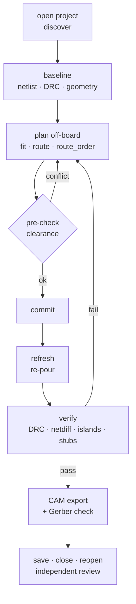

# lceda-pcb-automation: scripted PCB layout for EasyEDA Pro / LCEDA Pro / 嘉立创EDA专业版

**English** | [简体中文](README.zh-CN.md)

[](LICENSE)


Command-line PCB automation for **EasyEDA Pro / LCEDA Pro / JLCEDA / 嘉立创EDA专业版 4.x** (JLCPCB's
professional EDA tool). It drives the editor through its official CLI (`LCEDA-Pro invoke`):
- an **A\* autorouter** that runs on the real board geometry,
- placement search,
- ground-pour repair,
- **DRC, schematic-vs-PCB netlist diff and an independent Gerber check**.

It works as a **Claude Code / Agent Skills skill** ([`SKILL.md`](SKILL.md)), so an AI agent can route,
fix and ship a board. Every tool is also a plain script you can run yourself.

> One rule makes AI-driven layout safe: **plan the edit off-board, pre-check it, commit it, then
> verify it through a different path.** "The API said ok" is never accepted as proof.

## Why

LCEDA Pro has a capable JavaScript API and a CLI that can run it, but nothing that turns them into a
layout workflow. This repo adds that layer:

- **Real geometry, not guesses.** Pads, tracks, arc tracks, vias and the *computed* pour copper are
  exported into [shapely](https://github.com/shapely/shapely) geometry. Every tool works on that.
- **An autorouter that knows the rules.** A grid A\* router honours other-net clearance by rule class,
  keepouts, via hole-to-hole spacing, and "no via in pad". The ground pour counts as passable because
  it re-pours. Every result is pre-checked before it is written to the board.
- **Placement that has to route.** `fit.py` finds legal positions and rotations. `place_route.py`
  only accepts a position where every pad actually routes to its net.
- **Order-aware routing.** `route_order.py` tries net orders in memory, so the first net does not
  wall in the next.
- **Ground repair.** It finds floating ground pads after a re-pour, shows cut-off plane pockets in
  colour, and adds stitching and thermal vias.
- **Verification gates:**
  - DRC with the rules untouched;
  - schematic == PCB netlist;
  - island check and dangling-stub finder;
  - width histogram, neck finder and acute-corner finder;
  - footprint outlines kept apart (silkscreen, not just copper);
  - a save that is proven by reopening the file.
- **Shipping:**
  - Gerber/BOM/CPL export, optionally without silkscreen plus a generated assembly drawing;
  - an **independent check of the Gerber and drill files**: edge clearance, hole spacing, annular
    ring, mask dams, paste.

It was built while taking a dense 4-layer, 80 × 26 mm motor-controller board (ESP32-S3 + BLDC driver)
from schematic changes to DRC 0 and fab files. Every entry in
[`references/pitfalls.md`](references/pitfalls.md) actually happened on that board.

## Example

[`examples/ldo-breakout`](examples/ldo-breakout) is a 2-layer USB-C → 3.3 V LDO board. It goes from
placed-but-unrouted to DRC 0 and checked Gerbers with about 25 commands, in about 1.5 minutes.

| Start: placed, ratsnest only | After the walkthrough: DRC 0 |
|---|---|
|  |  |

## Workflow



## Quick start

```bash
git clone https://github.com/v0id-byte/lceda-pcb-automation && cd lceda-pcb-automation
python3 -m venv .venv && .venv/bin/pip install -r requirements.txt
export LCEDA_WORK=~/pcb-work/myboard && mkdir -p $LCEDA_WORK

cp board.eprj2 $LCEDA_WORK/rehearsal.eprj2            # rehearse on a copy first
bin/eda.sh open $LCEDA_WORK/rehearsal.eprj2 headless
bin/eda.sh js/discover.js                              # -> write $LCEDA_WORK/project.json (see examples/)

bin/eda.sh js/netlist_sch.js > sch.json && bin/eda.sh js/netlist_pcb.js > pcb.json
.venv/bin/python tools/netdiff.py sch.json pcb.json    # schematic == PCB?
.venv/bin/python tools/refresh.py --rebuild            # re-pour, export geometry
bin/eda.sh js/drc.js 600                               # "sum": {} means clean
.venv/bin/python tools/route_net.py SOME_NET --w 8     # dry run: path in mm + conflicts
.venv/bin/python tools/route_net.py SOME_NET --w 8 --commit --all
bin/eda.sh close destroy
```

The full workflow, the routing loop and the verification gates are in [`SKILL.md`](SKILL.md).
For a complete run on a real (small) board, follow the [example](examples/ldo-breakout).

### Use it as an agent skill

```bash
git clone https://github.com/v0id-byte/lceda-pcb-automation ~/.claude/skills/lceda-pcb-automation
```

Claude Code picks it up when you ask it to route, fix DRC on, verify or export a board in LCEDA /
EasyEDA Pro. Pair it with
[`easyeda-pro-claude-skill`](https://github.com/v0id-byte/easyeda-pro-claude-skill) for netlist-verified
schematic editing.

## What's inside

| Path | What |
|---|---|
| `bin/eda.sh` | CLI wrapper: `open`, `sessions`, `close`, run a JS file with `CFG` / `ARGS` / `pcb()` prepended |
| `js/` | one job per script: discover, export geometry and pour fills, add a pour, re-pour, DRC, netlists, save, Update PCB, Gerber, BOM/CPL, rip/move, net rules, region rules |
| `lib/` | `cfg` (project config, units), `pcbgeo` (geometry loader, arcs, islands), `router` (A\*), `check` (clearance), `eda` (run/commit), `camgeo` (Gerber parser) |
| `tools/` | `route_net` · `route_zone` · `route_order` · `manual` · `fit` · `place_route` · `move_part` · `move_via` · `gnd_fix` · `stitch` · `islands` · `stubs` · `courtyard` · `unoverlap` · `fix_overlaps` · `assembly_drawing` · `polarity_silk` · `vias_in_pads` · `dogbone` · `netdiff` · `widths` · `necks` · `angles` · `render` · `cam_export` · `camcheck` · `refresh` |
| `examples/` | `ldo-breakout`: a scripted 2-layer board in LCEDA's `.eprj3` folder format, before and after, with a walkthrough |
| `references/` | [`pitfalls.md`](references/pitfalls.md) (35 traps found on real boards), [`api-notes.md`](references/api-notes.md) (the LCEDA API calls used here and their quirks) |

## Requirements

- LCEDA Pro / EasyEDA Pro **4.1+** desktop client, which includes the CLI. On macOS the default
  binary path is used. Set `LCEDA_BIN` to override it on other platforms.
- Python 3.10+ with shapely 2, numpy, matplotlib and gerbonara.

## Limits

- The board outline is a rectangle plus keepout rectangles in `project.json`. Irregular outlines need
  `pcbgeo.OUTLINE` replaced.
- The router handles one net at a time. It is good for completing and repairing a layout, not for
  length-matched or impedance-controlled buses.
- LCEDA's internal formats (`.enet`, pour fill paths) have no stability promise. Re-run the baseline
  after an editor upgrade.

## Acknowledgements

This project stands on these open-source projects and tools:

| Project | Used for | License |
|---|---|---|
| [Shapely](https://github.com/shapely/shapely), built on [GEOS](https://libgeos.org/) | all board geometry: buffers, clearances, unions, spatial index | BSD-3-Clause (GEOS: LGPL-2.1) |
| [NumPy](https://numpy.org/) | router grids, `render.py` rasters | BSD-3-Clause |
| [Matplotlib](https://matplotlib.org/) | `render.py` copper and island plots | PSF-based Matplotlib license |
| [Gerbonara](https://gitlab.com/gerbolyze/gerbonara) by jaseg | parsing Gerber and Excellon files for the independent CAM check | Apache-2.0 |
| [easyeda/easyeda-api-skill](https://github.com/easyeda/easyeda-api-skill) and [easyeda/pro-api-sdk](https://github.com/easyeda/pro-api-sdk) | the reference for the EasyEDA Pro extension API | see the repositories |

Also thanks to:
- **JLC / EasyEDA** for the LCEDA Pro desktop client, its JavaScript API and the `LCEDA-Pro` CLI that
  makes scripting it possible. LCEDA Pro itself is proprietary freeware and is not distributed here.
- **Hart, Nilsson & Raphael (1968)**, "A Formal Basis for the Heuristic Determination of Minimum
  Cost Paths", *IEEE Transactions on Systems Science and Cybernetics* 4(2), for the A\* search the
  router uses.

## Disclaimer

This is an independent project and is not affiliated with or endorsed by JLC, JLCPCB or EasyEDA.
"EasyEDA", "LCEDA", "嘉立创EDA" and "JLCPCB" are trademarks of their owners. Check every board
yourself before you order it. The tools verify what they can measure, not your design intent.

## License

[MIT](LICENSE)
