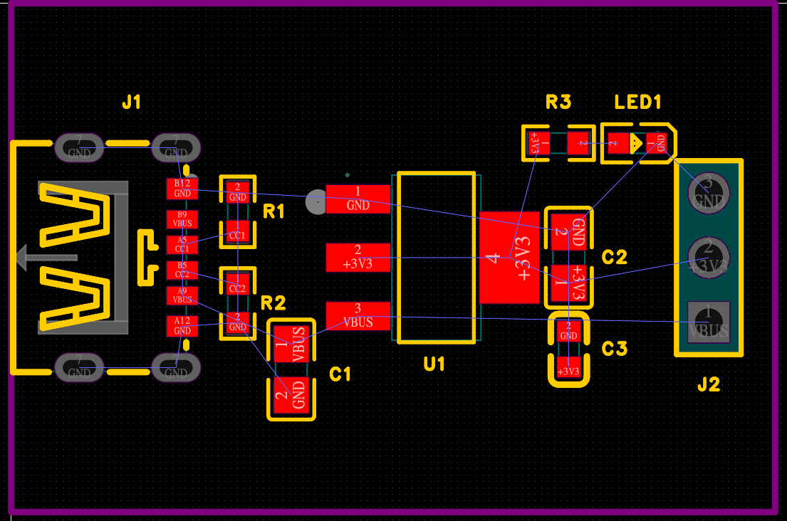
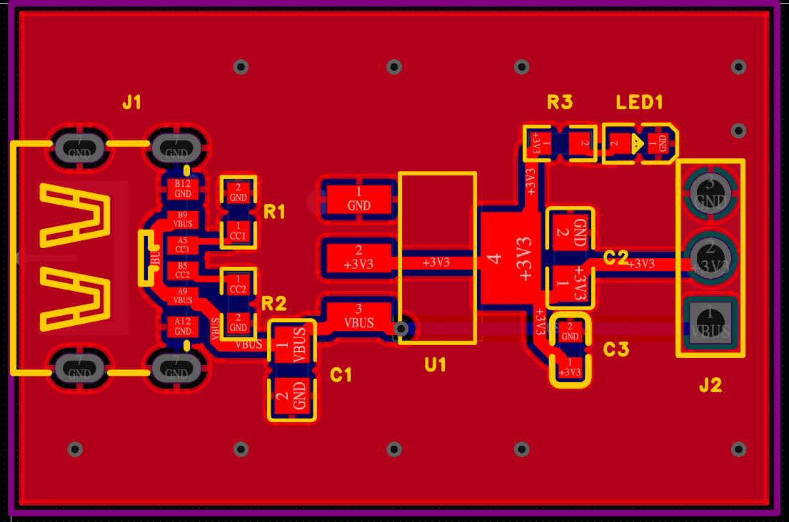
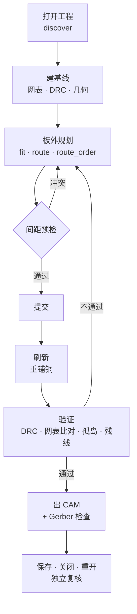

# lceda-pcb-automation：嘉立创EDA专业版 / EasyEDA Pro 的 PCB 自动化工具

[English](README.md) | **简体中文**

[](LICENSE)


这是一套命令行 PCB 自动化工具，面向**嘉立创EDA专业版（立创EDA专业版 / LCEDA Pro / EasyEDA Pro / JLCEDA）4.x**。它通过官方命令行工具 `LCEDA-Pro invoke` 驱动编辑器，提供这些能力：

- 在真实板图几何上跑的 **A\* 自动布线**
- 搜索器件摆放位置
- 修复铺铜后浮空的地
- **DRC、原理图与 PCB 网表比对、独立的 Gerber 检查**

它本身也是一个 **Claude Code / Agent Skills 技能**（见 [`SKILL.md`](SKILL.md)），可以让 AI 智能体完成布线、修 DRC、出生产文件。每个工具也都是普通脚本，可以自己手动跑。

> 让 AI 改板子靠谱的只有一条规矩：**先在板外规划，预检通过再提交，提交后换一条路径复核**。接口返回 ok 永远不算证据。

## 为什么做这个

嘉立创EDA专业版有一套完整的 JavaScript API，也有能执行这套 API 的命令行，但两者之间缺一套能拿来干活的布板流程。这个仓库补上了这一层：

- **用真实几何，不靠猜**。把焊盘、走线、圆弧走线、过孔，以及铺铜*实际算出来*的铜皮，都导出成 [shapely](https://github.com/shapely/shapely) 几何。所有工具都基于这份数据。
- **懂规则的自动布线**。网格 A\* 布线器会遵守：
  - 按规则类区分的异网间距
  - 禁布区
  - 过孔孔间距
  - 焊盘上不打孔

  地铺铜会重新铺，所以布线时当作可以穿过。每条结果写进板子之前都会先做间距预检。
- **摆得下，还要布得通**。`fit.py` 找出合法的位置和角度；`place_route.py` 只接受每个焊盘都能真正连回自己网络的位置。
- **考虑布线顺序**。`route_order.py` 在内存里试不同的网络顺序，避免先布的网把后布的网堵死。
- **修地**。重铺铜之后找出浮空的地焊盘，把被切断的平面孤岛用颜色标出来，并补缝合过孔和散热过孔。
- **验证门槛**：
  - 不放宽规则的 DRC
  - 原理图网表与 PCB 网表一致
  - 孤岛检查，悬空残线检查
  - 线宽分布、颈缩、锐角检查
  - 器件外形（丝印）互不重叠，不只是铜不碰
  - 关闭后重开文件，证明确实保存了
- **出生产文件**：导出 Gerber、BOM、坐标文件（可以不带丝印，另外生成装配图），再对 Gerber 和钻孔文件做**独立检查**：板边距、孔间距、焊环、阻焊桥、钢网。

这套工具是在一块高密度 4 层、80 × 26 mm 的电机控制板（ESP32-S3 + BLDC 驱动）上做出来的：从改原理图一直做到 DRC 0、出生产文件。[`references/pitfalls.md`](references/pitfalls.md) 里的每一条坑都是在这块板上真实踩到的。

## 示例

[`examples/ldo-breakout`](examples/ldo-breakout) 是一块 2 层的 USB-C 转 3.3 V LDO 小板。从“器件已摆好、没布线”开始，大约 25 条命令、1.5 分钟，就能做到 DRC 0，并导出检查过的 Gerber。

| 起点：器件已摆好，只有飞线 | 跑完教程：DRC 0 |
|---|---|
|  |  |

## 流程



## 快速上手

```bash
git clone https://github.com/v0id-byte/lceda-pcb-automation && cd lceda-pcb-automation
python3 -m venv .venv && .venv/bin/pip install -r requirements.txt
export LCEDA_WORK=~/pcb-work/myboard && mkdir -p $LCEDA_WORK

cp board.eprj2 $LCEDA_WORK/rehearsal.eprj2            # 先在副本上演练
bin/eda.sh open $LCEDA_WORK/rehearsal.eprj2 headless
bin/eda.sh js/discover.js                              # 按输出填写 $LCEDA_WORK/project.json（见 examples/）

bin/eda.sh js/netlist_sch.js > sch.json && bin/eda.sh js/netlist_pcb.js > pcb.json
.venv/bin/python tools/netdiff.py sch.json pcb.json    # 原理图和 PCB 一致吗
.venv/bin/python tools/refresh.py --rebuild            # 重铺铜并导出几何
bin/eda.sh js/drc.js 600                               # "sum": {} 表示没有错误
.venv/bin/python tools/route_net.py SOME_NET --w 8     # 试布：打印路径（mm）和冲突
.venv/bin/python tools/route_net.py SOME_NET --w 8 --commit --all
bin/eda.sh close destroy
```

完整流程、布线循环和验证门槛都写在 [`SKILL.md`](SKILL.md) 里。想在一块真实的小板上完整走一遍，就按[示例](examples/ldo-breakout/README.zh-CN.md)操作。

### 作为智能体技能使用

```bash
git clone https://github.com/v0id-byte/lceda-pcb-automation ~/.claude/skills/lceda-pcb-automation
```

装好以后，在 Claude Code 里让它给嘉立创EDA / EasyEDA Pro 的板子布线、修 DRC、做验证或出生产文件，它就会自动加载这个技能。原理图编辑请配合 [`easyeda-pro-claude-skill`](https://github.com/v0id-byte/easyeda-pro-claude-skill) 使用，那边每一步改动都会用网表核对。

## 目录

| 路径 | 内容 |
|---|---|
| `bin/eda.sh` | 命令行封装：`open`、`sessions`、`close`；运行 JS 文件时自动在前面加上 `CFG`、`ARGS` 和 `pcb()` |
| `js/` | 每个脚本只做一件事：查工程、导出几何和铺铜、新建铺铜、重铺铜、DRC、导出网表、保存、更新 PCB、Gerber、BOM/坐标、拆线和挪器件、网络规则、区域规则 |
| `lib/` | `cfg`（工程配置和单位换算）、`pcbgeo`（读几何、圆弧、孤岛）、`router`（A\*）、`check`（间距）、`eda`（执行和提交）、`camgeo`（Gerber 解析） |
| `tools/` | `route_net` · `route_zone` · `route_order` · `manual` · `fit` · `place_route` · `move_part` · `move_via` · `gnd_fix` · `stitch` · `islands` · `stubs` · `courtyard` · `unoverlap` · `fix_overlaps` · `assembly_drawing` · `vias_in_pads` · `dogbone` · `netdiff` · `widths` · `necks` · `angles` · `render` · `cam_export` · `camcheck` · `refresh` |
| `examples/` | `ldo-breakout`：一块用脚本做出来的 2 层板，工程是嘉立创EDA的 `.eprj3` 文件夹格式，有布线前和布线后两份，附操作教程 |
| `references/` | [`pitfalls.md`](references/pitfalls.md)：在真实板子上踩过的 35 个坑；[`api-notes.md`](references/api-notes.md)：用到的嘉立创EDA API 及其怪癖 |

## 环境要求

- 嘉立创EDA专业版 / EasyEDA Pro **4.1 及以上**的桌面客户端，命令行工具随客户端安装。macOS 使用默认安装路径，其他系统用环境变量 `LCEDA_BIN` 指定。
- Python 3.10+，以及 shapely 2、numpy、matplotlib、gerbonara。

## 局限

- 板框只支持一个矩形，外加若干矩形禁布区，写在 `project.json` 里。异形板框需要自己替换 `pcbgeo.OUTLINE`。
- 布线器一次只布一个网络，适合补全和修补布局，不适合等长或阻抗控制的总线。
- 嘉立创EDA 的内部格式（`.enet`、铺铜填充路径）没有稳定性承诺。升级编辑器后要重新跑一遍基线。

## 致谢

本项目依赖以下开源项目和工具：

| 项目 | 用途 | 许可证 |
|---|---|---|
| [Shapely](https://github.com/shapely/shapely)，底层是 [GEOS](https://libgeos.org/) | 全部板图几何运算：膨胀、间距、合并、空间索引 | BSD-3-Clause（GEOS 为 LGPL-2.1） |
| [NumPy](https://numpy.org/) | 布线网格；`render.py` 的栅格 | BSD-3-Clause |
| [Matplotlib](https://matplotlib.org/) | `render.py` 的铜皮图和孤岛图 | 基于 PSF 的 Matplotlib 许可证 |
| [Gerbonara](https://gitlab.com/gerbolyze/gerbonara)（作者 jaseg） | 解析 Gerber 和 Excellon 文件，用于独立的 CAM 检查 | Apache-2.0 |
| [easyeda/easyeda-api-skill](https://github.com/easyeda/easyeda-api-skill)、[easyeda/pro-api-sdk](https://github.com/easyeda/pro-api-sdk) | EasyEDA Pro 扩展 API 的参考资料 | 见各自仓库 |

另外感谢：

- **嘉立创 / EasyEDA** 提供嘉立创EDA专业版桌面客户端、它的 JavaScript API，以及能拿来写脚本的 `LCEDA-Pro` 命令行。嘉立创EDA专业版本身是免费的闭源软件，本仓库不包含也不分发它。
- **Hart、Nilsson 和 Raphael（1968）**的论文 *A Formal Basis for the Heuristic Determination of Minimum Cost Paths*（IEEE Transactions on Systems Science and Cybernetics 4(2)）。布线器用的就是其中的 A\* 搜索。

## 声明

这是一个独立项目，与嘉立创、JLCPCB、EasyEDA 均无关联，也没有得到它们的认可。“EasyEDA”“LCEDA”“嘉立创EDA”“JLCPCB”是各自所有者的商标。下单前请自己检查每一块板：这些工具只能核对它们测得到的东西，核对不了你的设计意图。

## 许可证

[MIT](LICENSE)
