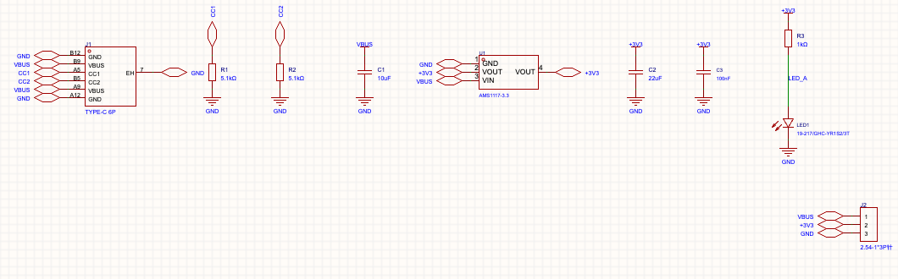

# 示例：USB-C 转 3.3 V LDO 小板（2 层，30 × 20 mm）

[English](README.md) | **简体中文**

这块小板把整套工具从头到尾走一遍：从“器件已摆好、还没布线”开始，一直做到 DRC 0、导出生产文件，全程只用命令行。整个流程大约跑 1.5 分钟。

| | |
|---|---|
| 器件 | USB-C 6P 母座、2 个 5.1 kΩ CC 下拉电阻、AMS1117-3.3、10 µF / 22 µF / 100 nF 电容、LED 加 1 kΩ 限流电阻、1×3 排针 |
| 网络 | `VBUS`、`+3V3`、`GND`、`CC1`、`CC2`、`LED_A` |
| 板子 | 2 层，30 × 20 mm，板框原点在 (0, 0) mil |
| 目录 | `start/`：器件已摆好，没有铜。`routed/`：按下面的步骤做完的成品。 |

两个工程都是嘉立创EDA专业版的文件夹格式（`.eprj3`），内容是一行一个 JSON，在 diff 里能直接看。这是一块演示板：通过了 DRC 和下面的 CAM 检查，但没有实际打样测试过。



| 起点：器件已摆好，只有飞线 | 完成：DRC 0，两层都铺了 GND |
|---|---|
|  |  |

两张截图都是嘉立创EDA 的真实画布，用 `eda.dmt_EditorControl.getCurrentRenderedAreaImage()` 截取。

## 操作步骤

先按[主页说明](../../README.zh-CN.md#快速上手)装好环境，然后在仓库根目录执行下面的命令。嘉立创EDA 打开 `.eprj3` 文件夹后会和它双向同步，所以**一定要在副本上操作**，不要直接打开仓库里的工程。

```bash
export LCEDA_WORK=~/pcb-work/ldo && mkdir -p $LCEDA_WORK
cp -R examples/ldo-breakout/start/ldo-breakout $LCEDA_WORK/
cp examples/ldo-breakout/project.json $LCEDA_WORK/
PY=.venv/bin/python

# 1. 打开工程，建基线。open 会自动写入会话 ID 和工程 uuid
bin/eda.sh open $LCEDA_WORK/ldo-breakout/ldo-breakout.eprj3 headless
bin/eda.sh js/netlist_sch.js > $LCEDA_WORK/sch.json
bin/eda.sh js/netlist_pcb.js > $LCEDA_WORK/pcb.json
$PY tools/netdiff.py $LCEDA_WORK/sch.json $LCEDA_WORK/pcb.json   # 10 个器件，没有差异
$PY tools/refresh.py
$PY tools/islands.py                                              # 所有网络都还是断开的

# 2. 布线：先布电源、用宽线，再布信号
$PY tools/route_net.py VBUS --w 20                                # 试布：打印路径（mm）和冲突
for net in VBUS +3V3; do $PY tools/route_net.py $net --w 20 --commit --all; done
for net in CC1 CC2 LED_A; do $PY tools/route_net.py $net --w 10 --commit --all; done

# 3. 地：两层都铺 GND，再沿板边打一圈缝合过孔，把两层连起来
bin/eda.sh js/add_pour.js 120 '{"net": "GND", "layers": [1, 2], "margin_mm": 0.3}'
$PY tools/refresh.py --rebuild
for p in 9,2.5 15,2.5 20,2.5 28.5,2.5 28.5,5 2.5,17.5 9,17.5 15,17.5 20,17.5 28.5,17.5; do
  $PY tools/stitch.py GND --n 1 --near $p --r 1.5 --via 12,24 --commit && $PY tools/refresh.py
done
$PY tools/refresh.py --rebuild
$PY tools/islands.py                                              # TOTAL missing links: 0

# 4. 验证
bin/eda.sh js/drc.js 600 | head -c 200                            # "sum": {}
bin/eda.sh js/netlist_pcb.js > $LCEDA_WORK/pcb2.json
$PY tools/netdiff.py $LCEDA_WORK/sch.json $LCEDA_WORK/pcb2.json  # 仍然没有差异
$PY tools/stubs.py && $PY tools/angles.py && $PY tools/widths.py VBUS +3V3

# 5. 导出生产文件，并对 Gerber 做独立检查
$PY tools/cam_export.py $LCEDA_WORK/cam --name ldo-breakout
$PY tools/camcheck.py $LCEDA_WORK/cam/gerber > /dev/null && cat $LCEDA_WORK/cam/gerber_report.json

# 6. 保存、关闭，再重开一次，证明确实存上了
bin/eda.sh js/save_all.js
bin/eda.sh close destroy
bin/eda.sh open $LCEDA_WORK/ldo-breakout/ldo-breakout.eprj3 headless
bin/eda.sh js/drc.js 600 | head -c 200
bin/eda.sh close destroy
```

## 预期结果

- **布线：** VBUS 和 +3V3 用 20 mil，CC1、CC2、LED_A 用 10 mil。VBUS 去排针的那段经一个过孔换到底层走。每次提交前都做过间距预检。
- **连通：** 第一次跑 `islands.py` 会报 25 条缺失连接，其中 13 条是 GND。布线、铺铜之后报 0。
- **DRC：** 用编辑器的默认规则，没有改过，结果是 `{}`。
- **CAM 检查：** 没有贴到板边的铜，孔间距、焊环都正常，丝印没有压到焊盘。另外两项不是问题：
  - `top_silk_off_board` 在 x ≈ 0 处约 0.46 mm²。这是 USB-C 的外框画在板边上，制板时会被裁掉。
  - `top_paste_off_copper` 每个焊盘只有百分之几 mm²。原因是库里封装的钢网开口比铜焊盘稍大，或者略有偏移。

如果编辑器或库里的封装有更新，你布出来的线可能和 `routed/` 里的略有不同。只要上面这些检查都通过就行。

## 这个示例是怎么做出来的

工程本身也是用脚本生成的：

1. 用 `dmt_Project.createProject` 新建工程；
2. 按 LCSC 编号从嘉立创库里搜索器件（`lib_Device.search`）；
3. 在每个引脚上放网络标识或网络端口，画好原理图，再用 `js/import_changes.js` 导入 PCB（执行两次）；
4. 用 `tools/fit.py` 把器件摆到目标点附近；
5. 把位号挪出焊盘。

通用流程见 [`SKILL.md`](../../SKILL.md)。
